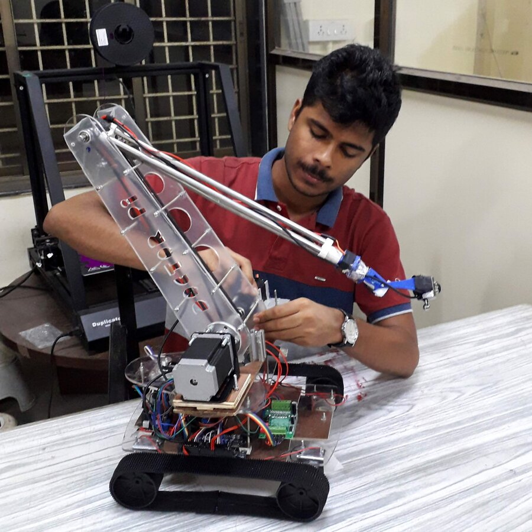
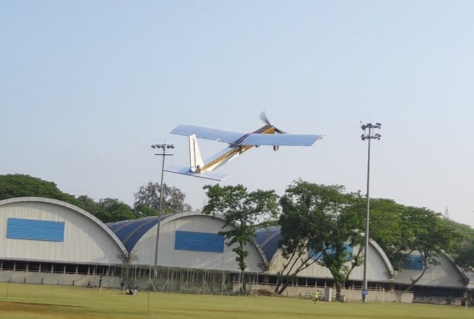
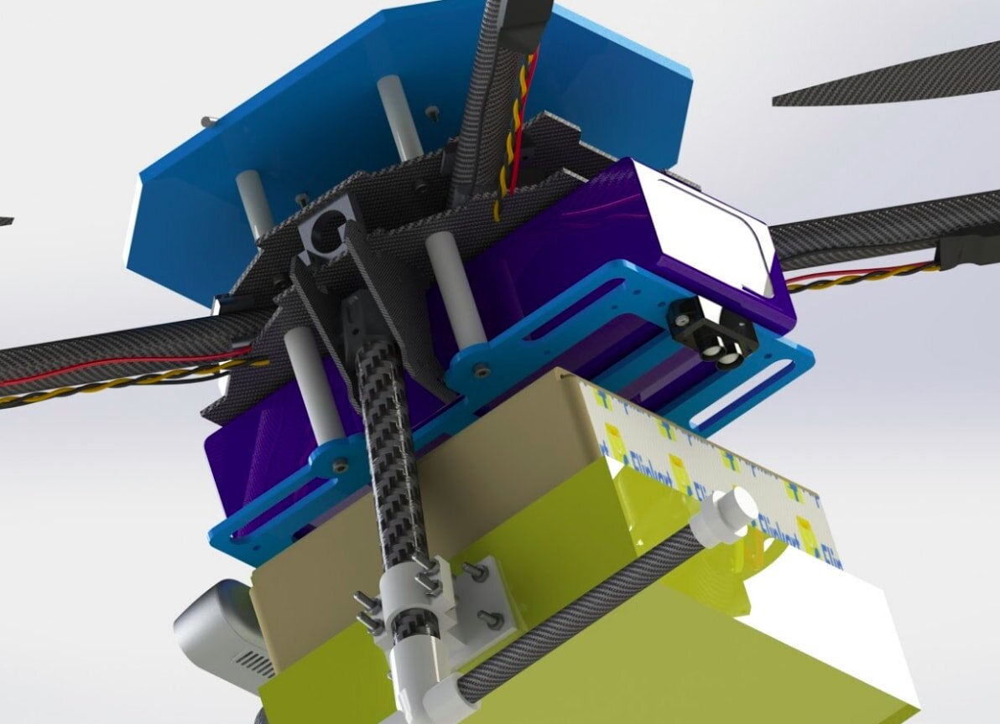

## Learning to build at IIT Bombay

I studied materials science and electrical engineering at IIT Bombay and graduated in 2023. The work that stuck with me happened around prototypes. Outside class, I worked on aerial robotics and co-founded [Agriyan](https://www.tiepune.org/in-sync-edition-45/), where we built an early prototype of a robot to help with farm work. Each project took us out of the neat world of drawings and specifications and into a messier question. Could the thing we had built actually do the job?

Two first-year projects showed me how much you can learn from a small build. [Doctor Pi](blog/doctor-pi-student-robot/) was a plant-inspection robot. We put a camera on an arm and tried to spot visible yellow patches on leaves. The hard part turned out to be getting the arm and camera to behave reliably together. Around the same time, I built [an eight-by-eight Snake game](blog/tiny-led-snake-game/) for an Arduino makerthon. The small display made every decision about controls and feedback obvious. Both taught me to finish a working version early enough to test it with somebody else.

I kept coming back to [what happens when parts have to work together](blog/what-robotics-teaches-you/). A drawing can make a design look settled. On a bench, a connector can come loose or a motor can draw more power than expected. [Giving a test a clear pass or fail](blog/writing-a-good-test/) helps you decide what to fix first, especially when several things are going wrong at once.

Project photos are from my earlier portfolio. Other photos are illustrative.

<figure class="journey-photo">
  
  <figcaption>The Doctor Pi prototype during the student project</figcaption>
</figure>

It was also where I learned [how to sit with a stubborn bug](blog/what-debugging-taught-me/). Sometimes a build would fail for most of the week and turn on one small change. The time wasn’t wasted if I came away with a better way to narrow down the next problem. I still think about [what to do when you have to make a trade-off](blog/working-with-constraints/) whenever time, money, and the scope of a project pull in different directions.

Later I worked on controls with Team AeRoVe at IIT Bombay. For the [Barcelona Smart Drone Challenge](blog/aerove-student-flight-projects/), we built trainer aircraft, went through design reviews, and did outdoor tests before the pandemic interrupted the event. A different kind of constraint showed up in the [Flipkart GRiD indoor drone project](blog/flipkart-grid-indoor-drone/). Inside a building there is no reliable GPS position, so our team had to establish what the aircraft could see and what the simulation could actually tell us. We qualified for the national final. I remember the work of making it to that milestone as much as the milestone itself.

<figure class="journey-photo">
  
  <figcaption>A Team AeRoVe trainer aircraft during outdoor testing</figcaption>
</figure>

<figure class="journey-photo">
  
  <figcaption>A design rendering from the Flipkart GRiD indoor drone project</figcaption>
</figure>

## Finding a problem worth solving

[Sipwise](https://sipwise.store/) began with a full water bottle next to me and a simple habit I kept missing. I’d sit down to work and go hours without taking a sip. The bottle and the water were both within reach. What I was missing was a cue that would reach me while I was paying attention to something else. [Starting with that everyday frustration](blog/starting-with-a-personal-problem/) gave me a clearer question to work on.

The idea was to put the reminder on the bottle itself. I was interested in [where a reminder fits into someone’s day](blog/designing-for-a-daily-habit/). If the cue is well placed, the next step takes a few seconds. If you have to pull out a phone, open an app, and find the bottle, you’ve written a small task into somebody’s day.

When I tried apps or alarms, I could dismiss them and stay focused on the work. By the time I noticed the bottle again, I’d already forgotten the reminder. The opportunity was in that short gap between seeing a cue and doing something with it. A light on the bottle was a way to put both steps in one place. It sounds like an obvious detail now, which is usually a sign that a problem has become easier to describe.

<figure class="journey-photo">
  
  <figcaption>Pouring a glass of water</figcaption>
</figure>

That is one reason I find [watching the first use](blog/watching-how-people-use-things/) more revealing than explaining the idea myself. An explanation smooths over the awkward parts. A bottle sitting on an actual desk gives you a better question. Will somebody notice it during the kind of work that made them forget to drink in the first place? A question like that makes it easier to [decide what can wait](blog/choosing-what-to-leave-out/) until you know more.

<figure class="journey-photo">
  
  <figcaption>A bottle within reach</figcaption>
</figure>

## From a prototype to the first Sipwise bottle

I started prototyping at IIT Bombay. The first meaningful test was modest. Could I make the bottle give me a reminder that I could see while working? I kept coming back to [the value of a simple early prototype](blog/keeping-the-prototype-simple/). It’s easier to change the placement of a light on a rough build than on a finished enclosure. It also helps to [write down what changed each time](blog/keeping-a-build-log/), especially if a version behaves differently for a reason you didn’t expect.

<figure class="journey-photo">
  
  <figcaption>Electronics work under a microscope</figcaption>
</figure>

It took months of testing and adjusting before we [shipped the first finished bottle](blog/shipping-the-first-sipwise-bottle/). Holding it was a big moment for me. It also brought up a new set of practical questions. Could the next one work the same way? What would happen when someone turned it on for the first time without the people who built it standing nearby? I’m still interested in [the gap between making one and making a batch](blog/from-one-unit-to-a-batch/), because a lot of the work that makes a product dependable lives in that gap.

One thing I kept from the student workshop was a preference for seeing something in use as soon as possible. With a physical product, the enclosure, the electronics, the way it feels in someone’s hand, and the instructions all affect the same experience. It takes real samples to see where those decisions interfere with each other. At the same time, it’s easier to learn from each sample when you know which decision you made differently.

<figure class="journey-photo">
  
  <figcaption>A warehouse floor</figcaption>
</figure>

## The work after launch

Once a product leaves your hands, you get a different kind of feedback. Somebody can tell you what happened during their first week, when they were busy or had forgotten the instructions. I think about [what to ask early customers](blog/listening-to-early-customers/) before drawing a conclusion. A request for a new feature can come from something as small as a step that was hard to find.

<figure class="journey-photo">
  
  <figcaption>A team around a shared table</figcaption>
</figure>

There’s also a wider question about [what counts as testing the whole product](blog/testing-the-whole-product/). The hardware matters, along with the box it comes in, the first setup, and what happens when someone comes back to it after a few days. [Turning a comment into a small test](blog/turning-feedback-into-a-test/) helps make that work specific. If several people get stuck in the same place, there’s a useful experiment to run before deciding what to build next.

A customer question can teach you where to look. Imagine someone can get the bottle working the first day but struggles a week later. I’d start by asking what they remember from setup and what they try when the device behaves differently. That makes it possible to improve something specific, whether it’s the explanation, the feedback the product gives, or a step we can remove altogether. It also reminds me that the product has to make sense long after the first demonstration.

<figure class="journey-photo">
  
  <figcaption>A notebook and pen</figcaption>
</figure>

## Outside work

I like running, sketching, and hiking. I enjoy [working an idea out on paper](blog/sketching-before-building/), especially when I can show the drawing to somebody and see what they think it means before I explain it. A rough sketch makes it easier to move a part, cross something out, or try a second version. It can also help me [ask for feedback I can use](blog/asking-for-useful-criticism/) while there’s still time to change the idea.

I used to make time for painting at IIT Bombay too. My old portfolio still has a Warli-style illustration and a project on telling stories with folk art. Looking back at those alongside the robots makes sense to me. Painting asks a similar question about what a person notices first. A sketch feels successful when someone can follow what’s happening in it and ask a question I hadn’t thought to ask.

<figure class="journey-photo">
  
  <figcaption>Warli-style artwork from my earlier portfolio</figcaption>
</figure>

I also like the change of attention that comes with being outdoors. When I’ve been turning a problem over for too long, [a little distance can make the next step clearer](blog/stepping-away-from-a-problem/). Sometimes that means coming back knowing exactly what to try. Sometimes it just means being able to see the question clearly again. I want this site to hold more of those observations as I keep building.

<figure class="journey-photo">
  
  <figcaption>A trail through the mountains</figcaption>
</figure>
