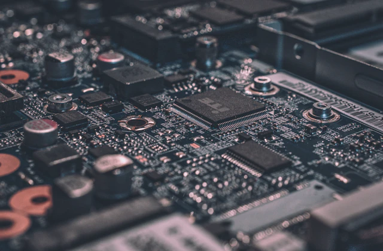

## Learning to build at IIT Bombay

I studied materials science and electrical engineering at IIT Bombay and graduated in 2023. The work that stuck with me happened around prototypes. Outside class, I worked on aerial robotics and co-founded [Agriyan](https://www.tiepune.org/in-sync-edition-45/), where we built an early prototype of a robot to help with farm work. Each project took us out of the neat world of drawings and specifications and into a messier question. Could the thing we had built actually do the job?

I kept coming back to [what happens when parts have to work together](blog/what-robotics-teaches-you/). A drawing can make a design look settled. On a bench, a connector can come loose or a motor can draw more power than expected. [Giving a test a clear pass or fail](blog/writing-a-good-test/) helps you decide what to fix first, especially when several things are going wrong at once.

The photos below are illustrative.

<figure class="journey-photo">
  
  <figcaption>A circuit board up close</figcaption>
</figure>

It was also where I learned [how to sit with a stubborn bug](blog/what-debugging-taught-me/). Sometimes a build would fail for most of the week and turn on one small change. The time wasn’t wasted if I came away with a better way to narrow down the next problem. I still think about [what to do when you have to make a trade-off](blog/working-with-constraints/) whenever time, money, and the scope of a project pull in different directions.

<figure class="journey-photo">
  
  <figcaption>Code on screen</figcaption>
</figure>

## Finding a problem worth solving

[Sipwise](https://sipwise.store/) began with a full water bottle next to me and a simple habit I kept missing. I’d sit down to work and go hours without taking a sip. The bottle and the water were both within reach. What I was missing was a cue that would reach me while I was paying attention to something else. [Starting with that everyday frustration](blog/starting-with-a-personal-problem/) gave me a clearer question to work on.

The idea was to put the reminder on the bottle itself. I was interested in [where a reminder fits into someone’s day](blog/designing-for-a-daily-habit/). If the cue is well placed, the next step takes a few seconds. If you have to pull out a phone, open an app, and find the bottle, you’ve written a small task into somebody’s day.

<figure class="journey-photo">
  
  <figcaption>Pouring a glass of water</figcaption>
</figure>

That is one reason I find [watching the first use](blog/watching-how-people-use-things/) more revealing than explaining the idea myself. An explanation smooths over the awkward parts. A bottle sitting on an actual desk gives you a better question. Will somebody notice it during the kind of work that made them forget to drink in the first place? A question like that makes it easier to [decide what can wait](blog/choosing-what-to-leave-out/) until you know more.

<figure class="journey-photo">
  
  <figcaption>A bottle within reach</figcaption>
</figure>

## From a prototype to the first Sipwise bottle

I started prototyping at IIT Bombay. The first meaningful test was modest. Could I make the bottle give me a reminder that I could see while working? I kept coming back to [the value of a simple early prototype](blog/keeping-the-prototype-simple/). It’s easier to change the placement of a light on a rough build than on a finished enclosure. It also helps to [write down what changed each time](blog/keeping-a-build-log/), especially if a version behaves differently for a reason you didn’t expect.

<figure class="journey-photo">
  
  <figcaption>Electronics work under a microscope</figcaption>
</figure>

It took months of testing and adjusting before we [shipped the first finished bottle](blog/shipping-the-first-sipwise-bottle/). Holding it was a big moment for me. It also brought up a new set of practical questions. Could the next one work the same way? What would happen when someone turned it on for the first time without the people who built it standing nearby? I’m still interested in [the gap between making one and making a batch](blog/from-one-unit-to-a-batch/), because a lot of the work that makes a product dependable lives in that gap.

<figure class="journey-photo">
  
  <figcaption>A warehouse floor</figcaption>
</figure>

## The work after launch

Once a product leaves your hands, you get a different kind of feedback. Somebody can tell you what happened during their first week, when they were busy or had forgotten the instructions. I think about [what to ask early customers](blog/listening-to-early-customers/) before drawing a conclusion. A request for a new feature can come from something as small as a step that was hard to find.

<figure class="journey-photo">
  
  <figcaption>A team around a shared table</figcaption>
</figure>

There’s also a wider question about [what counts as testing the whole product](blog/testing-the-whole-product/). The hardware matters, along with the box it comes in, the first setup, and what happens when someone comes back to it after a few days. [Turning a comment into a small test](blog/turning-feedback-into-a-test/) helps make that work specific. If several people get stuck in the same place, there’s a useful experiment to run before deciding what to build next.

<figure class="journey-photo">
  
  <figcaption>A notebook and pen</figcaption>
</figure>

## Outside work

I like running, sketching, and hiking. I enjoy [working an idea out on paper](blog/sketching-before-building/), especially when I can show the drawing to somebody and see what they think it means before I explain it. A rough sketch makes it easier to move a part, cross something out, or try a second version. It can also help me [ask for feedback I can use](blog/asking-for-useful-criticism/) while there’s still time to change the idea.

<figure class="journey-photo">
  
  <figcaption>Sketching at a workbench</figcaption>
</figure>

I also like the change of attention that comes with being outdoors. When I’ve been turning a problem over for too long, [a little distance can make the next step clearer](blog/stepping-away-from-a-problem/). Sometimes that means coming back knowing exactly what to try. Sometimes it just means being able to see the question clearly again. I want this site to hold more of those observations as I keep building.

<figure class="journey-photo">
  
  <figcaption>A trail through the mountains</figcaption>
</figure>
