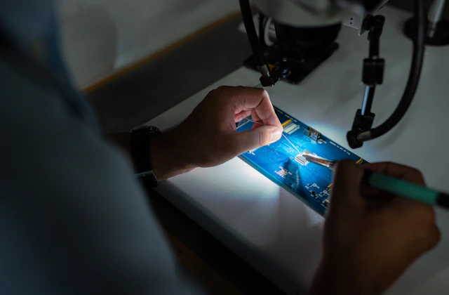
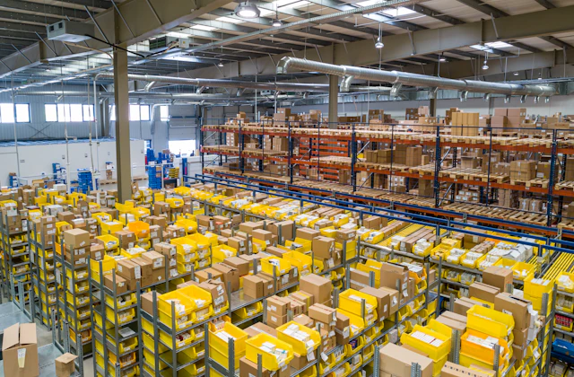
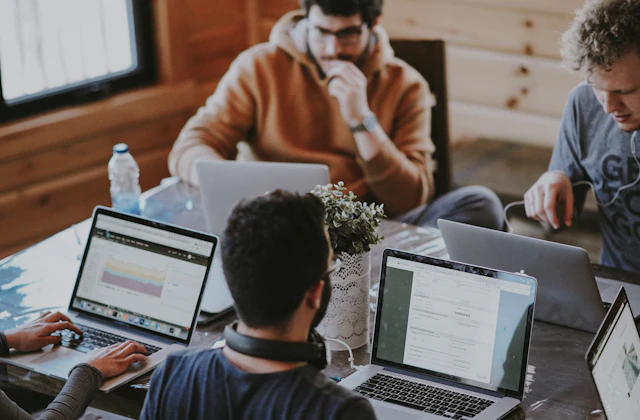
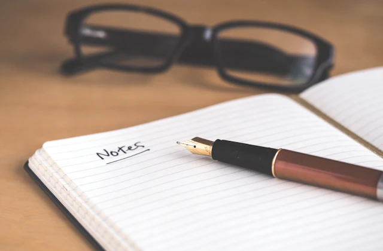
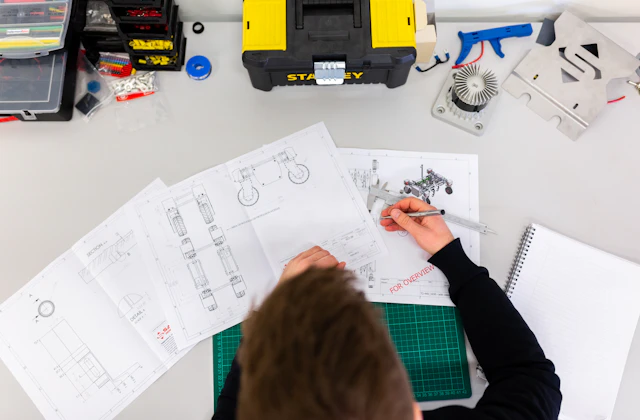

## IIT Bombay

I studied materials science and electrical engineering at IIT Bombay and graduated in 2023. Outside class, I worked on aerial robotics and co-founded [Agriyan](https://www.tiepune.org/in-sync-edition-45/), where we built an early prototype of a robot to help with farm work. Those projects got me thinking about [what robotics teaches you about building](blog/what-robotics-teaches-you/) and why learning [how to sit with a difficult bug](blog/what-debugging-taught-me/) still matters at Sipwise.

The photos below are illustrative.

  <figure>
    
    <figcaption>A circuit board up close</figcaption>
  </figure>
  <figure>
    
    <figcaption>Code on screen</figcaption>
  </figure>

## Finding the problem

[Sipwise](https://sipwise.store/) began with an everyday frustration. I could sit down to work with a full bottle beside me and go hours without taking a sip. That’s how I ended up [starting with a personal problem](blog/starting-with-a-personal-problem/) and thinking about [what makes a habit stick](blog/designing-for-a-daily-habit/) when your attention is somewhere else.

  <figure>
    
    <figcaption>Pouring a glass of water</figcaption>
  </figure>
  <figure>
    
    <figcaption>A bottle within reach</figcaption>
  </figure>

## Building the bottle

I started prototyping at IIT Bombay. The idea was to put the reminder on the bottle itself. [Keeping the first prototype simple](blog/keeping-the-prototype-simple/) is one way to find out whether an idea works before polishing it. It took us months of testing and tweaking before we got to [ship our first smart bottle](blog/shipping-the-first-sipwise-bottle/) and see someone else use it.

  <figure>
    
    <figcaption>Electronics work under a microscope</figcaption>
  </figure>
  <figure>
    
    <figcaption>A warehouse floor</figcaption>
  </figure>

## After launch

Getting something into someone else’s hands opens up a different set of questions. I’m still learning how to [listen to early customers](blog/listening-to-early-customers/) and what it means to [test the whole product](blog/testing-the-whole-product/), from the moment someone opens the box to the first week of using it.

  <figure>
    
    <figcaption>A team around a shared table</figcaption>
  </figure>
  <figure>
    
    <figcaption>A notebook and pen</figcaption>
  </figure>

## Outside work

Outside work, I like running, sketching, and hiking. There’s something useful about [putting an idea on paper](blog/sketching-before-building/) or [stepping away from a problem](blog/stepping-away-from-a-problem/) for a while. Both give me room to notice things I miss when I’m staring at a screen.

  <figure>
    
    <figcaption>Sketching at a workbench</figcaption>
  </figure>
  <figure>
    
    <figcaption>A trail through the mountains</figcaption>
  </figure>

